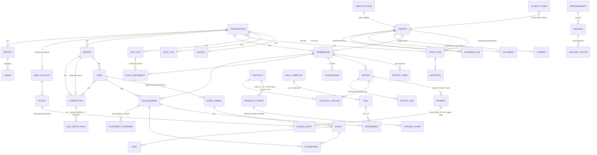

# SportGather — Rencana Implementasi MVP

> Status: **Disetujui dengan revisi (24 Nov 2026)**: lihat bagian 8 untuk jawaban pertanyaan. Belum ada kode yang ditulis.
> Sumber: `docs/PRD.md` (23 Nov 2026) dan Figma `vwWLfX9ncQFJK9g94jlAdl` (31 layar + user flow).
> Selisih PRD ↔ desain dicatat di `docs/decisions.md`.

---

## 1. Ringkasan pendekatan

- Satu **PWA Next.js** untuk tiga peran, dengan menu sesuai peran. Admin/owner dibuat desktop-first, pelatih dan wali mobile-first.
- Satu **backend NestJS** berbentuk modular monolith dengan REST + OpenAPI. Worker BullMQ memakai basis kode yang sama tetapi entrypoint-nya terpisah.
- **PostgreSQL + Drizzle**. Isolasi tenant ditegakkan di database lewat RLS, tidak hanya di kode aplikasi.
- **Mesin KU** ditulis sebagai fungsi murni di `packages/shared` dan dipakai bersama oleh API (penempatan, kenaikan) dan web (perkiraan KU di O-01).
- Semua integrasi eksternal (Midtrans, WhatsApp BSP, SMS, storage) berada di balik interface. Implementasi mock aktif secara default; implementasi nyata dipilih lewat env var.

Stack mengikuti rekomendasi PRD tanpa perubahan. Saya tidak mengusulkan alternatif karena stack ini sudah memenuhi bagian 8 dan cocok untuk tim kecil.

---

## 2. Struktur folder

```
sportgather/
├─ apps/
│  ├─ web/                      Next.js App Router (PWA)
│  │  ├─ app/
│  │  │  ├─ (public)/daftar/[orgSlug]/     O-01 formulir pendaftaran (tanpa login)
│  │  │  ├─ (public)/masuk/                O-02 login OTP · login email staf
│  │  │  ├─ (public)/t/[token]/            link bertoken (RSVP, bayar) dari WhatsApp
│  │  │  ├─ (admin)/[org]/…                A-01 … A-18 (layout sidebar)
│  │  │  ├─ (pelatih)/[org]/…              P-01 … P-05 (layout bottom nav)
│  │  │  └─ (wali)/…                       O-03 … O-08 (lintas klub, bottom nav)
│  │  ├─ lib/offline/                      IndexedDB + antrean sinkron absensi
│  │  └─ public/manifest.webmanifest, sw
│  └─ api/                      NestJS
│     └─ src/
│        ├─ main.ts / worker.ts            HTTP server · BullMQ worker
│        ├─ common/                        tenant context, RBAC guard, audit interceptor, error
│        └─ modules/
│           auth · org · staff · people · registration · documents · ku
│           season · teams · schedule · rsvp · attendance
│           billing (fee plan, invoice) · payments (Midtrans) · payouts (PayoutProvider)
│           notifications (WA/SMS/push, template, jam tenang) · announcements
│           development (skill, penilaian, rapor PDF) · reporting · audit · files
├─ packages/
│  ├─ db/          skema Drizzle, migrasi SQL (termasuk policy RLS), seed, helper withTenant()
│  ├─ shared/      tipe, skema Zod (kontrak API), mesin KU, util rupiah/tanggal/zona waktu
│  ├─ ui/          design tokens (dari Figma) + komponen dasar
│  └─ config/      tsconfig, eslint, prettier, vitest preset
├─ infra/
│  └─ docker-compose.yml   postgres, redis, minio, mailpit (nama project: sportgather)
├─ e2e/            Playwright
└─ docs/           PRD.md, plan.md, decisions.md, design/
```

**Kontrak API:** skema Zod di `packages/shared` dipakai untuk validasi di NestJS (pipe Zod) dan juga untuk menghasilkan OpenAPI. Klien web memakai tipe yang sama sehingga tidak ada definisi ganda.

---

## 3. Multi-tenant & RLS

| Kelompok tabel | Kunci tenant | Policy |
| --- | --- | --- |
| Data klub (branch, season, team, event, invoice, …) | `org_id NOT NULL` | `org_id = current_setting('app.org_id')::uuid` |
| Data orang lintas klub (`person`, `guardian_link`) | tidak ada | Terbaca jika (a) ada `membership` di org aktif, atau (b) person terhubung ke `app.user_id` sebagai diri sendiri/wali |
| Identitas & OTP (`user_account`, `otp_challenge`) | tidak ada | Hanya diakses modul auth lewat role khusus |

- Ada tiga role Postgres:
  - `sg_migrator` menjalankan DDL.
  - `sg_app` dipakai runtime, **tanpa** BYPASSRLS. Semua tabel tenant memakai `FORCE ROW LEVEL SECURITY`.
  - `sg_system` dipakai webhook/worker lintas tenant. Role ini tetap memasang `app.org_id` per org saat memproses data.
- Setiap request dibungkus `withTenant(orgId, userId, fn)`, yaitu transaksi + `set_config('app.org_id', …, true)`. Karena setting ini lokal per transaksi, tidak ada kebocoran konteks lewat connection pool.
- **Tes isolasi** (wajib lulus di CI) akan:
  1. Membuat seed dua klub.
  2. Membaca/menulis setiap tabel tenant dengan konteks klub A dan memastikan nol baris milik klub B terbaca.
  3. Memastikan query tanpa `app.org_id` gagal atau mengembalikan kosong.
  4. Memastikan endpoint API dengan ID milik klub lain mengembalikan 404.

Daftar tabel tenant diambil otomatis dari skema, sehingga tabel baru tanpa policy langsung membuat tes gagal.

---

## 4. Skema database awal (ERD)

Nominal uang disimpan sebagai `bigint` rupiah. Waktu disimpan sebagai `timestamptz`, sedangkan tanggal lahir dan tanggal acuan memakai `date`. Zona waktu disimpan per cabang (`Asia/Jakarta`, `Asia/Makassar`, `Asia/Jayapura`).



Catatan model:
- **`person`** tidak terikat tenant, sehingga satu wali bisa terhubung ke banyak klub (PAR-01). Data klub selalu menempel pada `membership`.
- **`team_member.ku_actual`** dan **`team.ku`** disimpan berdampingan. Selisih antara keduanya adalah play-up atau play-down, dan alasannya disimpan di `placement_override` (siapa, kapan, alasan, persetujuan owner).
- **`invoice`** punya unique key `(membership_id, fee_plan_id, period)` supaya tagihan ganda per periode tidak mungkin terjadi.
- **`gateway_event`** punya unique key `(order_id, transaction_status, status_code)`. Dengan begitu webhook duplikat tidak diproses ulang, sementara pembaruan status nyata tetap tercatat.
- **`ledger_entry`** adalah buku besar append-only. Setiap rupiah bagian klub menunjuk ke `payment_id` → `invoice_id` (US-13). Refund dan chargeback dicatat sebagai entri negatif yang dipotong dari penyaluran berikutnya.
- **`attendance`** punya `client_op_id` (UUID dari HP) yang unik, sehingga sinkron offline aman dijalankan berulang tanpa data ganda (US-09).
- **`audit_log`** append-only, berisi aktor, aksi, entitas, IP/UA, dan waktu. Kolom NIK disamarkan di tampilan dan tidak pernah ditulis ke log.

---

## 5. Mesin KU (`packages/shared/ku`)

```ts
type AgeRule = { kind: 'UNDER_N' } | { kind: 'MAX_N' };        // UNDER_N default
ageOn(birth: LocalDate, ref: LocalDate): { years, months }
eligibleGroup(birth, ref, groups: AgeGroup[], rule): AgeGroup | null
classifyPlacement(actual, target): 'SAME' | 'PLAY_UP' | 'PLAY_DOWN'
referenceDate(season, competition?): LocalDate                 // kompetisi utama, fallback 31 Des
proposePromotion(players, oldRef, newRef, groups): Proposal[]  // A-11
```

Semua fungsi di atas murni, tanpa `Date.now()` maupun I/O. Tes unit akan mencakup:
- ulang tahun tepat di tanggal acuan,
- lahir 29 Februari dengan acuan di tahun non-kabisat,
- batas KU7/KU8,
- grup satu tahunan vs dua tahunan,
- aturan `MAX_N`,
- play-up,
- play-down yang diblokir tanpa override owner,
- fallback 31 Desember.

---

## 6. Pembayaran & penyaluran

- **Alur bayar:** wali memilih tagihan → API membuat `checkout` → Midtrans Snap. Satu checkout bisa berisi beberapa tagihan, misalnya dua anak (O-05). `order_id` = ID checkout + suffix percobaan (keputusan Q3).
- **Biaya Midtrans di sisi wali (Q5):** biaya transaksi ditambahkan sebagai baris "Biaya layanan" di checkout. Besarnya dihitung per metode bayar (persentase untuk QRIS/e-wallet, flat untuk VA) dan ditampilkan sebelum wali membayar. Tagihan klub tetap utuh; biaya ini tidak masuk pendapatan klub. Tarif disimpan sebagai konfigurasi, bukan konstanta.
- **Biaya di sisi klub (Q5):** saat owner menarik dana, biaya transfer/penyaluran dipotong dari jumlah yang ditarik dan dicatat sebagai `ledger_entry` tersendiri.
- **Webhook:**
  1. Verifikasi `signature_key` (SHA512 dari order_id + status_code + gross_amount + server_key).
  2. Simpan ke `gateway_event`.
  3. Masukkan ke antrean.
  4. Worker memanggil **API status Midtrans**.
  5. Dalam satu transaksi: tandai lunas, tulis ledger, kirim notifikasi kuitansi.

  Pemrosesan dibuat idempoten dengan advisory lock per `order_id` dan pengecekan status terakhir. Nominal dari Midtrans juga harus sama dengan total checkout.
- **`PayoutProvider`:**
  - `registerRecipient(bankAccount)`
  - `verifyAccount(bankAccount)`
  - `splitInstructions(checkout)` (untuk Split)
  - `disburse(batch)` (untuk Iris)
  - `getStatus(ref)`

  Ada dua implementasi, `MidtransSplitProvider` dan `MidtransIrisProvider`, plus `MockPayoutProvider`. Implementasi Split ditandai `TODO(midtrans-split-confirmation)` sampai kemampuan dan bentuk API-nya dikonfirmasi Midtrans.
- **Pembayaran manual** (US-14) wajib menyertakan foto bukti dan mencatat siapa yang mencatat. Pembayaran ini tidak menghasilkan ledger fee platform.

---

## 7. Milestone

Setiap milestone ditutup dengan: tes lulus, lint + typecheck bersih, ringkasan perubahan, cara menjalankan, dan daftar sisa pekerjaan. Setelah itu saya berhenti untuk review.

| Milestone | Isi | Kebutuhan PRD | User story | Layar |
| --- | --- | --- | --- | --- |
| **M0 — Fondasi** | pnpm + Turborepo; TS strict; Docker Compose (pg, redis, minio, mailpit); CI GitHub Actions (lint, typecheck, test); token Figma ke Tailwind preset; font Plus Jakarta Sans; ikon (34 ikon desain); komponen Button, Badge, Input, Avatar, NavItem, TabItem, Logo, Card, Chip; layout admin (sidebar + topbar cari) dan mobile (app bar + bottom nav); PWA manifest + SW kosong; i18n `id` + format Rp/tanggal | NFR lokalisasi | — | 00 Design System |
| **M1 — Tenant, auth, RBAC** | Org, cabang, lapangan, rekening (status *menunggu verifikasi*); undangan staf; login OTP (WA mock → SMS mock setelah 30 dtk); email+password (+2FA opsional) untuk owner/admin; sesi; RBAC guard + scope "tim sendiri"; RLS + tes isolasi; audit log; persetujuan wali berversi | ORG-01, ORG-03, FEE-08 (status), NFR keamanan & privasi | US-01 | A-01, A-02, A-03, O-02 |
| **M2 — Pemain & KU** | Musim & kompetisi + aturan KU; mesin KU + tes; hitung ulang KU dengan pratinjau sebelum simpan; impor Excel/CSV (pemetaan kolom, error per baris, duplikat nama+tgl lahir, ≤2.000 baris <30 dtk); formulir pendaftaran wali (multi-anak, perkiraan KU, unggah dokumen terenkripsi); antrean verifikasi + audit buka dokumen + tolak wajib alasan; tim & penempatan (play-up/down); kenaikan KU massal; daftar & profil pemain | ORG-02, REG-01/02/03, KU-01/02 | US-02 … US-06 | A-04 … A-11, O-01 |
| **M3 — Jadwal & absensi** | Jadwal berulang (RRULE) yang menghasilkan sesi sampai akhir musim; ubah satu sesi; libur; event tunggal; link bertoken (48 jam, sekali pakai); RSVP terkunci 2 jam sebelum sesi; beranda & absensi pelatih offline-first (IndexedDB, sinkron idempoten, default dari RSVP); tim saya | SCH-01/02/03, ATT-01 | US-07 … US-09 | A-12, O-04, P-01, P-02, P-03 |
| **M4 — Iuran & pembayaran** | Paket iuran (bulanan/termin/per sesi), satu paket aktif per pemain, beasiswa 0–100%, biaya lain; biaya layanan Midtrans dibebankan ke wali di checkout; penarikan dana owner dengan potongan biaya transfer; job terbit tagihan (idempoten, lewati pemain cuti); Snap sandbox + webhook idempoten; catat bayar manual + bukti; kuitansi PDF; ledger; `PayoutProvider` (Split + Iris stub); penahanan penyaluran jika rekening belum terverifikasi; laporan penyaluran | FEE-01 … FEE-09, PAR-02 | US-10 … US-14 | A-13, A-14, A-15, O-05, O-06 |
| **M5 — Komunikasi, pembinaan, laporan** | Mesin notifikasi (template WA, jam tenang 21.00–06.00, gabung per wali per hari, push web); pengumuman bertarget + status terkirim/dibaca; pengingat jadwal & tagihan (matriks bagian 16); template skill basket per KU; penilaian (edit ≤7 hari oleh pembuat); rapor PDF + publikasi per semester; dashboard owner (cache ≤15 menit, angka sama dengan ekspor); laporan & ekspor Excel/PDF; profil wali, izin foto, unduh data, minta hapus | COM-01/02, DEV-02/03, RPT-01, FEE-06, PAR-01 | US-15 … US-18 | A-16, A-17, A-18, P-04, P-05, O-03, O-07, O-08 |
| **M6 — Siap pilot** | Seed fiktif Belajar Basket Akademi; e2e Playwright satu siklus penuh (tagihan terbit → bayar sandbox → lunas → ledger siap disalurkan); checklist keamanan (OWASP ASVS L2 ringkas, header, rate limit OTP, secret scan); dokumen deploy (region Jakarta) & runbook | DoD bagian 17 | US-01 … US-18 (regresi) | semua |

Perkiraan urutan risiko: tes isolasi RLS (M1) dan webhook idempoten (M4) adalah bagian paling kritis. Keduanya saya kerjakan dulu di milestone masing-masing.

---

## 8. Keputusan & pertanyaan

### Sudah diputuskan (24 Nov 2026)

| # | Topik | Keputusan |
| --- | --- | --- |
| Q1 | Kelompok KU | Default KU8, KU10, KU12, KU14, KU16 (dua tahunan). **KU7 = grup opsional** yang bisa diaktifkan per klub/kompetisi. |
| Q2 | Override play-down | **Hanya owner.** Play-up cukup oleh admin dengan alasan tercatat. |
| Q3 | Satu pembayaran, banyak tagihan | `order_id` = ID **checkout** + suffix percobaan. Satu checkout berisi 1..n tagihan, dan pelacakan per tagihan lewat ledger. |
| Q4 | Diskon saudara | **Dihapus dari MVP** (ditunda). Satu-satunya potongan adalah beasiswa 0–100%. Kriteria US-10 tentang diskon saudara tidak berlaku. Layar A-13 dan O-05 disesuaikan (tab/baris diskon saudara tidak dibuat). |
| Q5 | Biaya Midtrans | **Ditanggung dua pihak:** (a) wali membayar biaya transaksi sebagai "Biaya layanan" di checkout; (b) owner menanggung biaya transfer saat **menarik dana**. Lihat bagian 6 dan Q13 di bawah. |

### Masih terbuka

13. **★ Model penarikan dana (M4).** "Owner menarik uangnya" berarti dana klub ditampung dulu sebagai saldo, lalu ditarik owner ke rekening klub. Ini adalah skema **cadangan (Iris)** di PRD, bukan Split. Dengan Split, dana langsung dibagi Midtrans saat settlement sehingga tidak ada momen "menarik". **Usulan:**
    - Saldo klub per org di ledger.
    - Owner menekan "Tarik dana" (ada minimal penarikan) → Iris → biaya transfer dipotong.
    - Saldo yang ditarik hanya dana yang sudah settle dari Midtrans.

    Konsekuensinya: risiko izin BI (PRD bagian 12) jadi relevan dan perlu penilaian konsultan hukum sebelum dibuka ke banyak klub. Mohon konfirmasi: **penarikan manual oleh owner**, atau **penyaluran otomatis terjadwal** dengan biaya dipotong per penyaluran?
14. **Biaya layanan untuk QRIS.** Aturan QRIS Bank Indonesia setahu saya **melarang merchant membebankan MDR QRIS kepada pembeli**. Perlu dicek ke Midtrans/legal. **Usulan aman:** biaya layanan dibebankan ke wali untuk VA dan e-wallet. Untuk QRIS, biayanya ditanggung klub (dipotong dari saldo), atau QRIS dikenai "biaya platform" flat yang bukan MDR. Mohon pilih setelah dicek.
6. **Login staf.** Usulan: OTP WhatsApp untuk semua peran, plus email + password + 2FA opsional untuk owner/admin.
7. **Jadwal cair di skema Split.** Terjawab oleh Q13 bila memakai model penarikan.
8. **Akun pemain KU13+.** Usulan: tidak dibuat di MVP.
9. **Nama produk.** Usulan: SportGather, dengan domain `sportgather.id`.
10. **BSP WhatsApp & SMS.** Memakai mock dulu sampai vendor dipilih.
11. **Penomoran tagihan.** Usulan: `INV-{YYMM}-{urut 4 digit per org per bulan}`.
12. **Hosting/CI.** Usulan: GitHub Actions; cloud region Jakarta dipilih di M6.

Pertanyaan yang ★ hanya menghalangi M4. M0–M3 bisa berjalan.

---

## 9. Di luar lingkup MVP (pengingat)

Semua fitur P1/P2 tidak masuk MVP: tryout (REG-04), deteksi bentrok jadwal, absensi pelatih, alarm absen 3×, chat tim, kurikulum yang bisa diedit penuh, pustaka drill, paspor pemain, perbandingan cabang, serta modul publik, turnamen, dan toko. Paket langganan berbayar juga tidak dikerjakan; datanya ada di skema, tetapi belum ada billing langganan.
